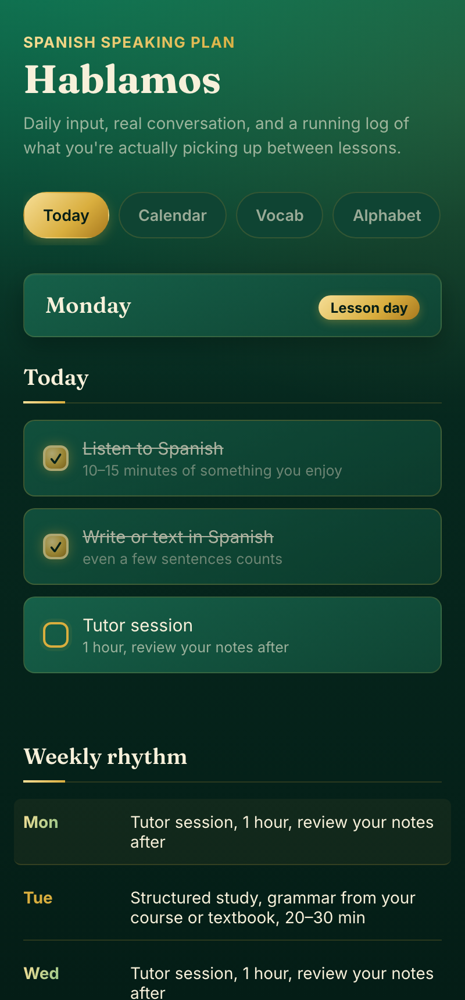
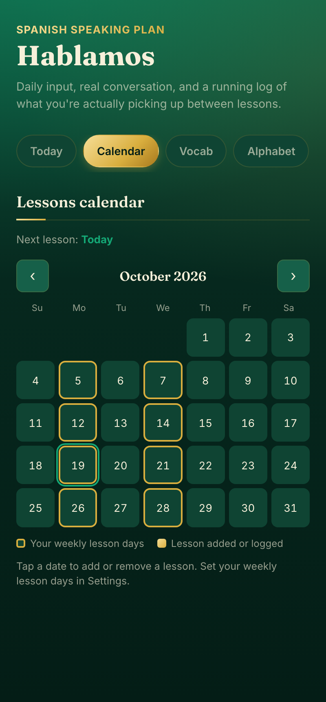
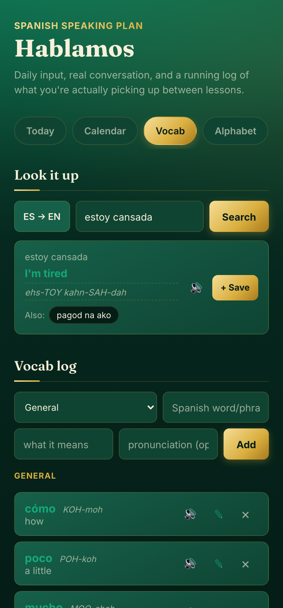

# Hablamos

A daily Spanish practice planner for self-directed learners who also work with a tutor.

**Live demo:** _add your GitHub Pages link here_

  
  
  

## Why it exists

A weekly lesson with a tutor is the easy part of learning Spanish. The hard part is the six days in between, when nobody is checking whether you listened, practiced or remembered anything. Most apps either replace the tutor or ignore them. Hablamos is built for the learner who already has a tutor and wants a companion for the rest of the week: a daily routine to check off, a calendar of lessons, a personal vocab log with pronunciation, and quick reference tools for the grammar that comes up in class. It runs in the browser, works on a phone, and needs no account.

## Features

- **Today.** A daily checklist built from your lesson days, with a streak that counts consecutive days you finish everything. A weekly rhythm shows what each day is for.
- **Lessons calendar.** Your weekly lesson days are ringed. Tap any date to add a one-off lesson or log one you had. Shows when your next lesson is.
- **Dictionary lookup.** Spanish to English and back, using the free MyMemory API. Shows the translation most sources agree on, offers the others as one-tap alternatives, and lets you edit before saving.
- **Vocab log.** Save words by category (numbers, colors, animals, household, physical and mental states). Edit, delete, and hear any word read aloud. Ships with about 100 starter words.
- **Pronunciation guide.** Every word gets an English-friendly respelling with the stressed syllable in capitals, like *cansado* → kahn-SAH-doh. It is generated from the spelling, so it works offline and for any word. It switches between Latin American and Spain pronunciation.
- **Alphabet.** All 27 letters with their names, read aloud on tap.
- **Verb conjugator.** Present tense for regular -ar, -er and -ir verbs, about 55 common irregular and stem-changing verbs, and reflexive verbs (*llamarse* → me llamo).
- **Grammar reference.** Subject pronouns, regular verb endings, ser vs. estar, and how Spanish numbers are built from 0 to 100. Every word can be tapped to hear it.
- **Flashcards.** Practice your whole vocab log: flip, step through, shuffle, listen.
- **Settings.** Choose your lesson days, a start date, what to call a lesson, your accent and your voice.

## How it was built

I designed and directed this product, and I built it by iterating with Claude, Anthropic's AI model, as my pair-programmer. I did not hand-write the code. My part was deciding what the app should do and for whom, using it alongside my own Spanish lessons, noticing what was wrong or missing, and directing each round of changes until it worked the way a learner needs it to.

Some decisions that came out of that process:

- The pronunciation guide was first built on a public dictionary API. Testing showed that API only returns results for English, so it was replaced with a guide generated from Spanish spelling rules, which works for every word and needs no network.
- The dictionary's top result is sometimes wrong (crowd-sourced memory once returned a Tagalog sentence for *estoy cansada*). Instead of trusting the first result, the app now picks the translation most sources agree on and shows the rest as alternatives.
- Everything a learner adds is stored under its own prefix in the browser, because every GitHub Pages project on one account shares the same storage.

## Tech stack

- A single `index.html` file: vanilla HTML, CSS and JavaScript, with no framework and no build step
- `localStorage` for all saved data
- Web Speech API (`speechSynthesis`) for reading Spanish aloud
- [MyMemory Translation API](https://mymemory.translated.net/doc/spec.php) for dictionary lookups (free, no key)
- Google Fonts: Fraunces and Inter

## Run it locally

Download `index.html` and open it in a browser. That's all. To serve it the way GitHub Pages does, run `python3 -m http.server` in the folder and open `http://localhost:8000`.

## Customize it

Lesson days, start date, lesson name, accent and voice are set in the app's **Settings** tab. The rest of the routine lives in clearly labeled constants at the top of the `<script>` in `index.html`:

| Constant | What it controls |
|---|---|
| `DAILY_TASKS` | The habits on the checklist every day |
| `WEEKLY_PLAN` | The extra task for each day that is not a lesson day (0 is Sunday) |
| `DEFAULT_SETTINGS` | What a new user starts with in Settings |
| `CATEGORIES` | The vocab categories and their order |

## Known limitations

- **Data lives only in the browser.** Clearing site data, or switching browsers or devices, starts you over.
- **No accounts or sync.** There is no way to move your vocab between your phone and your laptop yet.
- **The conjugator covers a curated list of irregular verbs.** Verbs outside the list are conjugated with the regular pattern, and the app says so when it does.
- **Speech quality depends on the device.** The app picks the best Spanish voice it can find, but what is available varies by browser and operating system. On iPhone, better voices can be downloaded under Settings > Accessibility > Spoken Content > Voices > Spanish.
- **The dictionary is a free service** with a daily limit of about 5,000 characters per user, and its suggestions should be checked, which is why the translation stays editable.

## Roadmap

- **Spaced repetition.** Schedule flashcards by how well you know each word instead of cycling through all of them.
- **Accounts and sync.** Keep one vocab log across phone and laptop.
- **A voice conversation partner.** Speak Spanish out loud and get a spoken reply with gentle corrections, steered toward the words you're learning.

## License

MIT. See [LICENSE](LICENSE).
